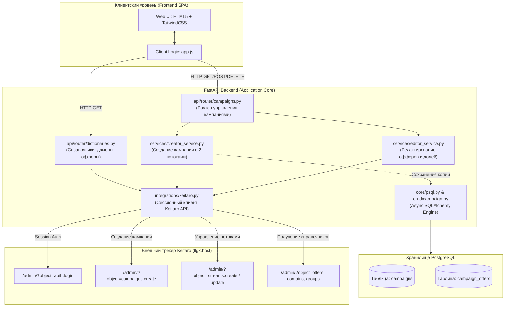

# Архитектурная диаграмма проекта (UML / Mermaid)

Диаграмма иллюстрирует взаимодействие между клиентом, FastAPI бэкендом, базой данных PostgreSQL и трекером Keitaro API.

## Пояснения к диаграмме компонентов

1. **Client (Web SPA)**:
   - Вкладка **Создаватор кампаний**: форма ввода параметров, валидация двухбуквенного гео-кода и ID оффера, быстрый выбор из выпадающего списка.
   - Вкладка **Редактор существующей кампании**: селектор кампаний, просмотр потока Google-фильтрации, интерактивная таблица офферов целевого потока с кнопками удаления и формой добавления.

2. **Backend Services**:
   - `services/creator_service.py`: отвечает за генерацию безопасного alias, создание базовой кампании и двух потоков (Google-редирект с фильтром страны + целевой поток офферов).
   - `services/editor_service.py`: инкапсулирует логику поиска потока с офферами, добавления/удаления ID оффера и автоматического пересчета весов (`share`).

3. **Database (PostgreSQL & Alembic)**:
   - `campaigns`: хранит локальный аудит созданных кампаний.
   - `campaign_offers`: хранит историю и конфигурацию привязанных офферов.

4. **Keitaro Tracker Integration**:
   - Автоматическая сессионная аутентификация в Keitaro (`auth.login`).
   - Использование преднастроенного домена (ID `1813`), группы (ID `9799`) и источника трафика (ID `836`).
